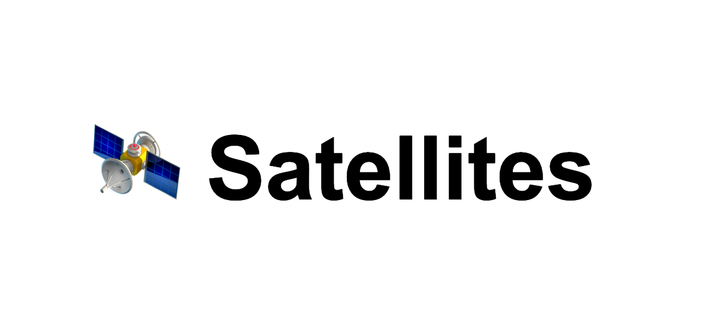

:tada: Satellites - Launch a DEX Marketplace of NFT

:earth_americas: The Satellites use the [0x protocol](https://0x.org/) and the [Original Extension Contracts](https://medium.com/blockbase/development-of-new-0x-extensions-passer-and-distributor-contract-4b169ad8c607).

:mega: The Satellites team uses [IssueHunt](https://issuehunt.io/) for a sustainable open-source ecosystem.

## Quick start

``` bash
# install repository
$ git clone https://github.com/block-base/satellites.git

$ cd satellites

$ cd templates

# install dependencies
$ npm install

# serve with hot reload at localhost:8080
$ npm run dev
```

#### Customization
1. Open the `plugins/config.ts` file and edit the params:

    - `networkIdToTokens` -- The Ethereum address which be hundled assets of ERC721.(default CryptoKitties) More information of the other assets can be [found here](https://github.com/block-base/satellites/wiki/ERC721-Asset-List).

    - `ownerAddress` -- The Ethereum address which you receive the fee recipient in orders your relayer.

    - `ownerFeeRatio` -- The percentage of the fee which you receive.

2. Open the `nuxt.config.ts`file and edit service name etc.

3. Launch a [0x-launch-kit-backend](https://github.com/0xProject/0x-launch-kit-backend). If you want to open Market quicly, you can use Satellites relayer.
    -  mainnet : `https://relayer-mainnet.nftsatellites.com/v2/`
    - rinkeby : `https://relayer-rinkeby.nftsatellites.com/v2/`


## Referral links

Append `ref=0x...` to a marketplace or asset URL, using `?ref=...` or `&ref=...` as appropriate. The value must be a single nonzero 20-byte hex address. The Nuxt middleware retains it during the current SPA visit, including navigation to an asset. An explicit invalid or repeated `ref` parameter clears it; it is not stored in cookies or persisted across reloads without the parameter. Address hex syntax is checked, not an EIP-55 checksum.

`templates/plugins/config.ts` sets `referralOwnerFeeIndex` to the owner entry (index 1 by default) and `referralShareBps` to 5000, meaning half of that entry's fee, not an extra buyer charge. Operators can choose a value from 0 to 10000. Index 0 is reserved for the platform allocation and cannot be selected. The code splits the already-rounded owner amount, with the rounding remainder staying with the owner. All fees are integer base units; the sum remains the same as the existing configured fee schedule rounded down per recipient. Self-referrals and addresses already in the fee schedule do not redirect fees. The configured schedule is never mutated.

The referral is passed to the existing distributor transaction path. No additional contract, account, key or signing flow is introduced. An actual payment is not proven merely by constructing these parameters.

Offline regression instructions and verification boundaries are in [tests/referral/README.md](tests/referral/README.md).

## Supporting Satellites
Satellites is an open source project. This is an independent project.
When using Satellites, a fee of the marketplace sales (default 1%) will be provided to Satellites development funds.

The money is distributed to contributors and maintainers.
More information of the Ecosystem can be [found here](https://github.com/block-base/satellites/wiki/Ecosystem).

And If you use Satellites please consider becoming a backer:

[](https://issuehunt.io/r/block-base/satellites)

## More Infomation
- [Discord](https://discord.gg/tdTegPC)
- [Twitter](https://twitter.com/satellites_js)
- [Medium](https://medium.com/blockbase)

## License
[Apache license 2.0](./LICENSE)
